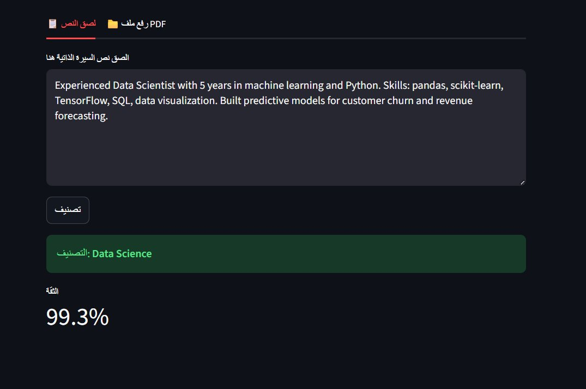
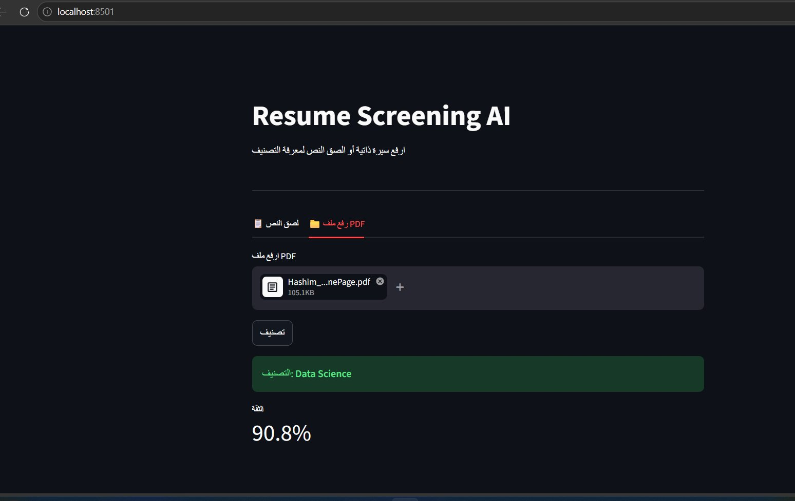

# Resume Screening with Machine Learning

Classifies a resume into one of **25 job categories** from its text, and ships as a **Streamlit web app** that accepts pasted text or a PDF upload and returns the predicted category with a confidence score.

M.Sc. Data Science project, Majmaah University.



## The problem

A single job posting can attract hundreds of resumes. Manual first-pass screening is slow, inconsistent between reviewers, and qualified candidates get missed. This project tests whether a classical NLP + ML pipeline can route resumes to the right category reliably and instantly.

## Data

- **962 labeled resumes** across **25 job categories** (Kaggle, English)
- **Data quality check:** only **166 of the 962 resumes are unique**; the other 796 (83%) are exact duplicates. Evaluating on the raw data lets the same resume appear in both training and test folds, which inflates accuracy, so all reported results use the de-duplicated set (3 to 13 resumes per category).

## Pipeline

1. **Preprocessing**: remove URLs, emails and phone numbers; strip special characters and digits; lowercase; remove English stopwords (NLTK).
2. **Features**: TF-IDF vectorization. Distinctive terms carry the signal, e.g. *pandas* points to Data Science, *Spring Boot* to Java Developer.
3. **Models**: Logistic Regression, Random Forest, XGBoost, and a soft Voting ensemble.
4. **Validation**: Stratified 5-Fold cross-validation.
5. **Deployment**: the best model, TF-IDF vectorizer and label encoder are saved with joblib and served in a Streamlit app (text or PDF input, top-3 predictions, offline).

Training code: [`train_model.ipynb`](train_model.ipynb) (the original project notebook, which evaluates on all 962 rows and reports ~99%; those figures include duplicates and are superseded by the table below).

## Results (Stratified 5-Fold CV on unique resumes)

| Model | Mean accuracy | Std. dev. |
|---|---|---|
| **Voting ensemble** | **88.5%** | 5.2% |
| **XGBoost** | **86.2%** | 2.4% |
| Random Forest | 75.4% | 7.8% |
| Logistic Regression (default settings, untuned) | 41.6% | 4.2% |

**About 86–88% accuracy on resumes the model has never seen**, across 25 categories. With only 166 unique resumes the estimates move by a few points between folds. TF-IDF is fitted inside each fold so no information leaks from the test data. See [`duplicate_check.ipynb`](duplicate_check.ipynb) for the full comparison.

## The app

`app.py` loads the saved model and, for any resume pasted or uploaded as PDF, shows:

- **Predicted category** with a confidence score
- **Top-3 most likely categories** with probabilities
- **Extracted details**: email, phone, education level, years of experience, languages, and detected skills
- A short summary (word count, number of skills found)

| Paste text | Upload PDF |
|---|---|
|  |  |

```bash
pip install -r requirements.txt
streamlit run app.py
```

The app expects the trained artifacts in `trained_models/`: `xgboost_model.joblib`, `tfidf_vectorizer.joblib`, `label_encoder.joblib` (produced by the training notebook).

## Limitations & next steps

- TF-IDF captures word frequency, not meaning; categories with overlapping vocabulary can be confused.
- Small data: 166 unique resumes, English-only, 25 categories. More (and more varied) resumes per category is the biggest lever for accuracy.
- Next: Sentence-BERT embeddings for semantic matching, SHAP for explainable predictions, and a learned (not keyword-list) skill extractor.

## Tech

Python · scikit-learn · XGBoost · NLTK · pandas · Streamlit · joblib
